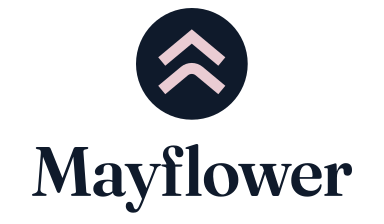

<h1 align="center">
  
</h1>

Mayflower is a systemic library for non-custodial & decentralized incentive games on public blockchains.

The [Amplifying Value Machine](./avm/rust/mayf-avm-prog/README.md) implements a deterministic issuance schedule for claims on a reserve, while preserving a never-decreasing minimum redemption value.

Bidders commit credits in timed auctions for a share of funded rewards. See
[Reward Clearing](./reward-clearing/README.md).

## Status

Currently incomplete and unstable. Code is actively being migrated from private repositories to here.

Alpha release date TBD. You'll be one of the first to know.

## Getting acquainted

Explore the [wiki](https://github.com/mayflower-system/mayflower/wiki) for explanation & specification of the modules.

Use the [Mayflower brand kit](./browser/theme/README.md) for app styles, pamphlets, and flowcharts.

Engage in [discussions](https://github.com/mayflower-system/mayflower/discussions). Announcements will be posted here.

## Talk to maintainers

Inquiries can be sent to contact@mayflower.systems

## Testing

The mono-repo is primarily written in Rust and Typescript.

To verify tests, run:

```bash
cargo test
pnpm test
```

## License

Apache 2.0
