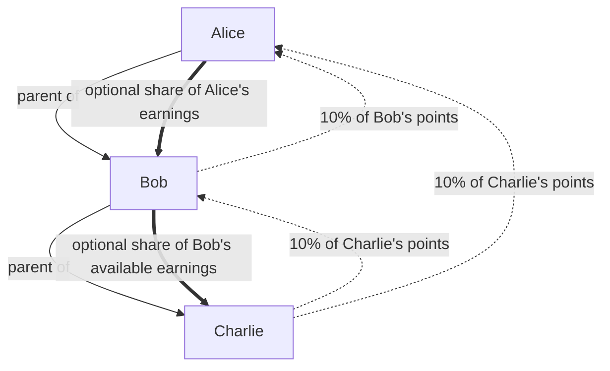

<!--
title: Referral Network Diagrams
summary:
  Diagrams showing upline overrides, voluntary sharing, and the division of a
  reward stream.
tags:
  - referral
-->

These diagrams illustrate the [Referral Network](Referral-Network) in ideal
arithmetic, with maximum depth 2 and a 10% override rate. They track attribution, not
transfers of deposited principal.

## One deposit, three recipients

Charlie has 100 own points at depth 2. The source assigns 10 points to each
upline member and retains 80:

```text
Alice (depth 0)   receives 10 points from Charlie
  └─ Bob (depth 1)   receives 10 points from Charlie
       └─ Charlie (depth 2) retains 80 of his own points
```

The three allocations sum to Charlie's original 100 points. If Alice and Bob
also have deposits, each deposit is allocated along its own upline, and a
member's core points are the sum of its retained own attribution and overrides
from its downline.

## Overrides up, gifts down



Overrides are calculated from each source's own points. A gift is a portion of the
parent's available earnings, divided among its direct children by their own
points. Gifts can be shared onward but do not generate a second round of
overrides.

## From rewards to final earnings

```text
Eligible own points + permanent upline
              │
              ▼
   Core points: own retention + overrides from downline
              │
              │  reward rate ÷ total own points
              ▼
        Core reward earnings
              │
              │  voluntary gifts flow from parents to children
              ▼
       Final retained earnings
```

The total counts each source's own points once. Overrides and gifts determine who
retains the resulting allocation; they do not increase the budget. When the
reward rate or point total changes, earnings depend on the values in effect as
participation accrued. [Formal Specification](Referral-Network-Formal-Specification)
gives the equations, and [Mutualization](Mutualization) works
through a numerical example.
