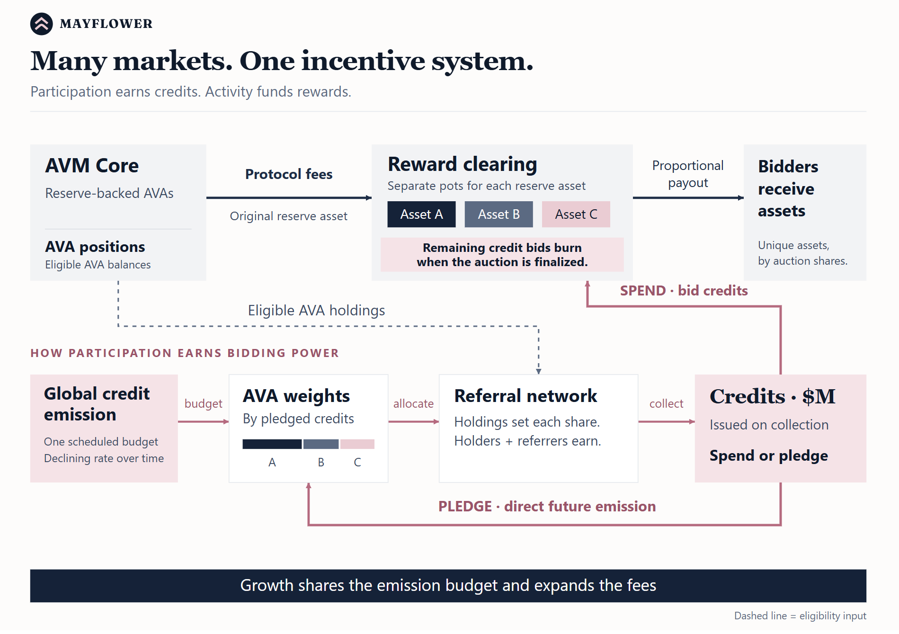

# Voluntary upgrade of Nirvana & Samsara
*How existing positions on Nirvana & Samsara will be given the choice to transfer into Mayflower's connected ecosystem*

## Summary

- In the next 45 days, we will release a comprehensive proposal detailing a voluntary upgrade of the Solana program code connected to accounts on the Nirvana and Samsara protocols
- The primary benefit of the upgrade is to connect existing accounts to the new Mayflower platform and its extensible reward & governance module
- The proposal itself will be settled by a vote with the prANA tokens (produced by the Nirvana protocol)
  Voting will not open sooner than 30 days after the proposal is published
- If the proposal passes, existing Nirvana & Samsara accounts will not be forced to participate in the upgrade. Participation will be voluntary. By default, existing accounts on Nirvana & Samsara will remain under the existing protocol
- Whether the proposal passes or not, the current Nirvana & Samsara protocols will maintain continuity of service
- Most saliently, the minimum redemption rates (the “floor price”) for positions on Nirvana & Samsara will not be diminished as a result of the proposed upgrade. Nor will the minimum redemption rate be diminished by the voluntary transfer of positions into the new implementation.
- The automated redemption schedules on Mayflower will not have a lower minimum redemption rate (“floor price”) than their partner schedules on Nirvana & Samsara. But be advised that the process with transferring accounts into new issuance schedules may affect the momentary marginal redemption rate for value-at-risk above the minimum. Since it is not possible to perfectly copy Nirvana & Samsara’s existent marginal redemption schedule under a new program if less than 100% of the existing positions choose to transfer their claims, there cannot be a guarantee on exact liquidity structure above the minimum rate. The future complete proposal will provide a specification for how the deterministic schedule will be copied into a new program with minimal discontinuity to the momentary marginal redemption rate for accounts that both choose to transfer and those that do not.
- More information will be provided in the lead-up to the complete proposal. Join in the discussion on the public forums at: https://github.com/mayflower-systems/mayflower/discussions

## Background

Mayflower’s charter is to pursue the ideals of decentralization as far as is possible when it comes to permissionless programs operating on digital value with deterministic algorithms. It aims to be genuinely “on-chain” in the sense that algorithms – not humans – act as trustless guarantees for every facet of its system.

Most notably, this idea took early shape with the “Amplifying Value Machine” (AVM) – a deterministic issuance & redemption schedule that “amplifies” the value of an arbitrary token. The amplification results from how the AVM schedule produces a minimum redemption rate (the “floor price”) for all “Amplified Value Assets” (AVAs). The floor rate cannot decrease, and so the floor rate can outperform the very same token it exchanges. For example, the floor rate of the AVM based on Solana’s SOL has increased 599% since inception, meaning that 1 SOL deposited from the start would be worth almost 7 SOL today.

In effect, we have a demonstration that a “market” can operate in the absence of human “market makers.” The protocol does not depend on centralized entities in order to fulfill its intended purpose.

The stability of the AVM protocol comes from having no essential entanglements with third-parties. It merely applies a system of deterministic algorithms on quantities of tokens, without knowing anything else about them. The protocol does not know the “real” value of these tokens, since that would require trusting some custodial data provider outside the protocol. It cannot in principle guarantee what a third-party custodian promises.

As far as AVMs go, this isolation is a feature. Algorithmic purity is the whole reason they continue to work as specified. But as an ecosystem, it is unable to advantage itself by absorbing value out of the broad, fast-changing environment. And as a platform, it does not incentivize new growth from total strangers.

The proposed upgrade is mainly about this exact paradox: how to collect value from exogenous & unpredictable sources, while also requiring absolute zero custodial administration for how that value gets applied?

## Incentive to upgrade

The Mayflower system is being designed with this explicit goal: extensible value amplification via absolutely non-custodial algorithms.

This system must be able to collect incentivizing rewards in any token and distribute it to any participant according to perfectly deterministic rules. It would introduce dangerous fault-lines if that incentive system depended on – for example – “price oracles” to report on the relative value between different tokens. And it could not hope to be permanent if it needed occasional emergency administrative intervention.

The incentive protocol should be as neutral as HTTP, as balanced as the rules of chess, and future-proof in precisely the way that worries us today about SHA256.

There will be a series of articles going into the weeds about how this system works and why the design matters. For now, a brief overview on its main components and some helpful contrast to what is in place with Nirvana & Samsara.

At the foundational level, the core AVM protocol is permissionless. Anyone is free to build with it and extend it. But as the activity on each AVA routes through its code, the protocol collects fees in all the various tokens that interact with it. These tokens could be “real world assets” or 100,000 new ephemeral memecoins. There is no censorship at the protocol level.

All of these collected fees need to be distributed. Since the algorithmic protocol cannot trust a centralized entity to report on the “price” of these tokens, the only remaining option is to let an organic market bid for the various pots of collected tokens. The protocol simply makes it possible for people to compete with each other, and thereby calibrate an exchange value.

The protocol distributes revenue it receives from external usage in order to increase internal growth. Revenue acts as an open incentive to maintain stake in AVAs themselves. But stake can unfairly concentrate in entities who have a disproportionately large amount of capital. The problem with collusion & concentration frequently challenges the scalability of many permissionless incentive systems (in particular the paradigm of incentives with blockchain “mining” or “validation”).

What is needed is not only an incentive to maintain economic stake, but also an incentive to recruit different people who have no incentive to collude. Real decentralization does not come from many “tokens” but from many hands, where each set is self-interested.

And so Mayflower employs a “referral network” in order to distribute a finite supply of “credits” that are used for bidding on the reward clearing module. Credits are earned in proportion to an individual’s own stake in addition to the aggregate of everyone who traces their own chain of recruitments back to him. If Alice recruits Bob and Bob recruits Charlie, Alice benefits from Charlie and Bob together.

All together, this is a substantial upgrade from Nirvana & Samsara. While Nirvana emits credits based on stake, these credits are not engineered to become scarce. And while they both have algorithmic ways of distributing accumulated revenue back to their AVMs, the system does not have sufficient market dynamics in order to make a material impact on adoption. The design is not inherently “wrong” – just not as effective as it could be.

Hence, a proposed new model for connecting the various components of the protocol into a system that is both open to the outside, but runs according to pure algorithms on the inside.

Those curious to learn more today can review the live specification and reference implementations at the project's [GitHub Wiki](https://github.com/mayflower-systems/mayflower/wiki).

## Road map ahead

Another embodiment of “decentralization” is that an upgrade as substantial as this should not be forced on accounts that exist with Nirvana & Samsara. Which is why there will be a comprehensive proposal, then a vote, and finally execution.

In the next 45 days there will be a comprehensive specification of Mayflower’s algorithmic systems and a specification of how the account transfer would work. Voting on the proposal will take place no sooner than 30 days after publication.

The vote is essentially about making it possible for existing accounts on Nirvana & Samsara to choose to transfer their positions into the unified Mayflower system. If the vote rejects the proposal, the existing accounts on Nirvana & Samsara will not be able to transfer, and the open-source Mayflower platform will “start fresh.” In either case, Nirvana & Samsara will continue to operate and provide issuance & redemption with preserved minimum rates.

In the jargon of “blockchains”, this kind of situation is similar in spirit to a “fork” – where a new system spins up and imports data from the original one. In the case of Nirvana & Samsara what must be “imported” is not merely data, but the reserve tokens that secure the redemption schedule. It is a “fork” of finite reserves, such that each parallel protocol maintains the floor price for the segmented accounts.

The main carry-over would be the “prANA” token itself. There will be a one time voluntary conversion of prANA tokens into the new Mayflower “credits”, after which the Mayflower credit emission system will operate independently of Nirvana’s prANA. By admitting both current position balances and earned prANA tokens, Mayflower “carries forward” personal exposure to Nirvana & Samsara, and installs it in a new algorithmic system.

You can glean that the priority is to treat this upgrade with the same respect given to the AVM’s floor. At bottom, the Nirvana & Samsara protocol is a semantic promise more than it is codebase – namely the promise that all deposits can be redeemed at no worse rate than the current floor. This promise must stay true even through such a substantive migration. And even if there is a supermajority consensus that the upgrade should happen, the dissenters are not forced into following the majority, and may keep their accounts with the current protocols.

After this transitional chapter concludes, the protocols will be put on a track toward 100% immutable blockchain programs and genuine autonomy. Optimizations & security fixes are necessary parts of the software lifecycle. But the spirit of this project prioritizes simplicity & stability over rapid feature growth. Each potential protocol-level update is judged by whether that change will bring it closer to never needing another update again. Unique among the technology landscape, blockchains make it possible to host immutable executable systems, and that is a challenge worth taking on.
