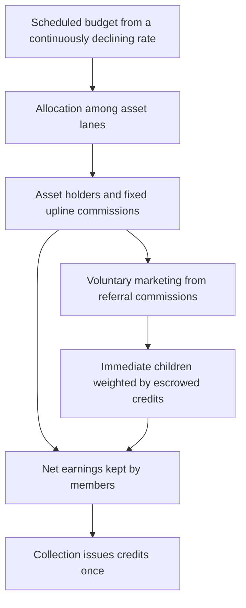

<!--
title: Mayflower
summary:
  Reserve-backed markets, scheduled credit emissions allocated through a referral
  tree, credit-funded family marketing, and public revenue clearing.
tags:
  - mayflower
-->

Mayflower connects reserve-backed asset markets with a credit allocation system.
The [Amplifying Value Machine](Amplifying-Value-Machine) defines market pricing
and redemption. The [Referral Network](Referral-Network) divides credit rewards
among participating asset holders and their ancestors. Parents can offer some of
their referral income to attract children. [Revenue Clearing](Revenue-Clearing)
lets credit holders compete for funded reward pots.

The referral and credit pages describe the allocation rules in the
[implementation handoff](https://github.com/mayflower-systems/mayflower/blob/a1f87bfa8469630444626ddbc11536512c78bb16/referral/rust/mayf-referral/SPEC.md).
The pure referral kernel implements admission receipts, family credit escrow
accounting, and the sharing and settlement rules. Auctions, the emission schedule,
token custody, and transaction authorization belong to the surrounding programs.
These pages describe the design, without claiming that the integration is deployed.

## One credit budget, several allocation decisions

The planned global emission rate decreases continuously. Credits continue to
accrue while that rate is positive, but progressively more slowly. Over each
time interval, there is one scheduled budget to divide: the integral of the
emission rate over that interval. More nodes, more assets, and more referral
links do not create another budget. The earlier constant-rate assumption was a
simplification for analyzing allocation, not the intended emission policy.

These decisions have separate purposes:

| Layer | What it determines | Who controls it |
| --- | --- | --- |
| Root-seat admission | Access to scarce top-level positions | Protocol auction; winning credit payment is burned |
| Lane allocation | Each asset market's portion of global emission | External allocator, such as credit gauge voting |
| Core referral allocation | Asset holders' and ancestors' earnings | Fixed tree depth and commission rules |
| Ordinary admission | Price of joining a particular parent | Parent's credit fee and optional price increment |
| Family marketing | Redistribution of a parent's referral commissions | Parent's marketing percentage and children's credit escrow |

An **asset lane** has its own eligible balances and denominator. BTC, ETH, and
SOL quantities are never added together. Lane allocation decides their relative
credit budgets; the referral rule divides each lane's budget. The simplified
single-asset model assigns the entire budget to that lane. See
[Credit Emissions](Credit-Emissions).

## A permanent tree with finite earning depth

There is one logical, non-earning protocol root. Scarce auctioned seats are the
first earning members, at depth zero. Each subsequent member chooses a permanent
parent. The maximum earning depth is $H$; members at that depth can still earn
credits and receive family marketing, but cannot recruit children.

A deposited asset's credit attribution pays a fixed fraction $q$ to each earning
ancestor. A holder at depth $d$ keeps $1-dq$ of that attribution. The rule requires
$q>0$ and $Hq<1$, so every permitted depth retains a positive own-asset share.
Parents benefit from assets held throughout their downline, including
grandchildren, without counting those assets again in the global denominator.

Finite depth makes positions different vertically: higher positions retain more
of their own attribution and have more recruiting room. Scarce auctioned seats
control entry at the top. These are explicit access rules, not proof that one
account corresponds to one person. The
[referral rationale](Referral-Network-Rationale) explains the limited
self-referral neutrality guarantee and the strategies it does not prevent.

## Why one referral link can differ from another

A parent controls its ordinary join fee and a discretionary **marketing
percentage**. Marketing shares only that parent's gross referral commissions;
its own asset income, admission fees, and incoming gifts stay outside the pool.
Immediate children divide the pool in proportion to issued credits they escrow
with that parent.

This lets siblings benefit from a shared family's downline activity. It also
gives a newcomer concrete terms to compare: the entry fee, remaining recruiting
depth, marketing percentage, commission income feeding the pool, and competing
escrow. A high advertised percentage alone does not establish a valuable offer.

The parent may change its percentage for future earnings, including setting it
to zero. Children may withdraw their escrowed principal after accrued earnings
are settled; their parent connection remains permanent. The system enforces
earned entitlements, not a promise of future generosity. See
[Mutualization](Mutualization) and [Link Shopping](Link-Shopping).

## Credits have distinct uses

Credits become issued tokens when earned entitlements are collected. Once issued,
they can be transferred, paid as an ordinary join fee, escrowed for family
marketing, pledged to emission channels, or committed to an auction.

| Use | What happens to the credits |
| --- | --- |
| Ordinary child admission | Transferred to the parent's owner |
| Winning root-seat payment | Burned when the authorized seat is activated |
| Family marketing escrow | Remain the child's withdrawable principal |
| Channel pledge | Remain committed until the holder reduces the pledge |
| Revenue clearing | Subject to the clearing auction's commitment and forfeiture rules |

The reference integration uses exclusive custody: the same principal cannot
simultaneously back family escrow, a channel pledge, a clearing commitment, and
an auction bid. Using one family's escrow to weight all lanes feeding that
family is a single use of the principal.

Burns reduce issued supply; they do not replenish the emission budget. A first
root-seat auction also needs a documented pre-existing credit supply. The design
has no automatic issuance to pay for its own initial seats. See
[Mayflower Credits](Mayflower-Credits) and
[Emission Accounting](Emission-Accounting).

## Markets and revenue clearing

The [AVM](Amplifying-Value-Machine) is a deterministic pricing and redemption
mechanism backed by its reserve. Its [floor-raising rules](AVM-Floor-Raising)
describe how reserve-backed minimum redemption prices can increase. Optional
features include [cash advances](Cash-Advance-Overview),
[call options](Call-Options), and [floor investment](Floor-Investment).

Market policy and curve parameters are separate from emission weighting. Gauge
pledges direct the credit budget among asset lanes; they do not change an AVM's
price curve or confer parameter authority.

Market activity can fund a revenue-clearing reward pot. Participants commit
credits under the clearing auction's entry, withdrawal, and forfeiture rules;
surviving weighted shares determine their portions of the pot. This auction is
separate from root-seat admission. It distributes funded rewards rather than
creating referral positions or increasing credit emission.

## Where to continue

- [Referral Network](Referral-Network): the rules and a guide to the referral pages.
- [Formal Specification](Referral-Network-Formal-Specification): allocation formulas and invariants.
- [Referral Rationale](Referral-Network-Rationale): incentives, tradeoffs, and limits.
- [Earning Credits](Earning-Credits): the paths from participation to collected credits.
- [Emission Accounting](Emission-Accounting): changing balances, settlement, and supply.
- [Revenue Clearing](Revenue-Clearing): using credits to compete for funded rewards.
