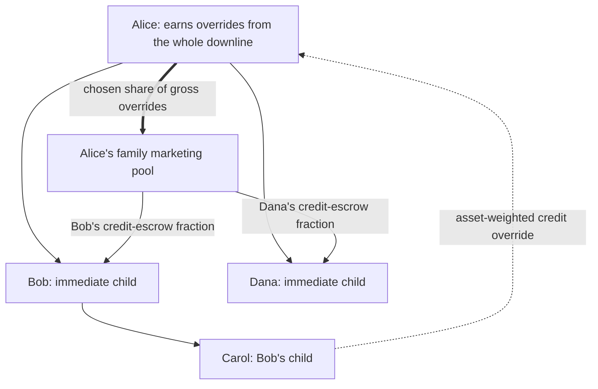

<!--
title: Referral Network Diagrams
summary:
  Diagrams of scarce top-level admission, fixed upline commissions, and
  discretionary family allocations weighted by credit escrow.
tags:
  - referral
-->

These diagrams illustrate the [Referral Network](Referral-Network). Examples use
$H=2$ and $q=10\%$ for clarity; they are not deployment defaults. Reward
attribution changes who earns credits, not ownership of deposited assets.

## The root does not earn

```text
Protocol root: no assets, commission, or family pool
├─ Alice: auctioned earning seat, depth 0
│  ├─ Bob: ordinary member, depth 1
│  │  └─ Carol: ordinary member, depth 2
│  └─ Dana: ordinary member, depth 1
└─ Eve: another scarce auctioned seat, depth 0
```

Winning seat payments in credits are burned. Bob's join fee instead goes to
Alice, and Carol's goes to Bob. Carol is at depth $H$ and cannot accept
children, but can earn from her own assets and escrow credits with Bob.

Every accepted parent edge is permanent. Changes to asset balances or credit
escrow do not move those edges.

## One source, three core recipients

Suppose Carol's eligible assets receive 100 credits of gross attribution during
an interval:

```text
Alice, depth 0   receives 10 override credits from Carol's source
  └─ Bob, depth 1   receives 10 override credits from Carol's source
       └─ Carol, depth 2   retains 80 own-asset credits

                    10 + 10 + 80 = 100
```

Each ancestor's commission is 10% of the same source attribution. Other asset
positions are divided along their own ancestry in the same way. The commissions
do not create a second reward budget.

## A family's pool crosses sibling branches



Carol's participation can increase Alice's pool. Dana can receive part of that
income by escrowing credits, even though Carol is not in Dana's own downline.
The denominator is Bob's and Dana's credit escrow, not their assets or the
number of descendants. Bob's received family allocation is kept; it does not
enter Bob's own marketing pool.

## From emission to retained credits

```text
Scheduled global credit budget
              │
              ▼
External allocation among asset lanes
              │
              ▼
Each lane: eligible asset balances + permanent earning ancestry
              │
              ├─ Own-asset income ───────────────────────────┐
              │                                             │
              └─ Gross downline overrides                   │
                         │                                   │
                         ├─ Parent's retained portion ───────┤
                         │                                   │
                         └─ Discretionary marketing pool     │
                                  │                          │
                                  ▼                          ▼
                         Immediate children             Parent's own
                         divide by credit escrow        net entitlement
```

The parent's incoming family allocation is also retained, outside its outgoing
pool. The global rate decreases continuously; the budget shown is the amount
accrued over the interval, not a constant rate for all future intervals.
Children's escrow principal is not spent or added to the emission budget. If
there is no child escrow, the parent retains its entire override income.

## Three different uses of credits

```text
Ordinary join fee:        newcomer ── credits ──> parent's owner
Winning auction payment: winner   ── credits ──> burn
Family stake:            child   <── credits ──> escrow custody
```

Escrow is withdrawable. A paid fee belongs to the parent and cannot also remain
the child's stake. Received marketing credits can be collected and explicitly
restaked for later accrual.

[Formal Specification](Referral-Network-Formal-Specification) gives the
equations; [Emission Accounting](Emission-Accounting) explains how changing
balances and marketing terms are settled without reallocating earlier earnings.
